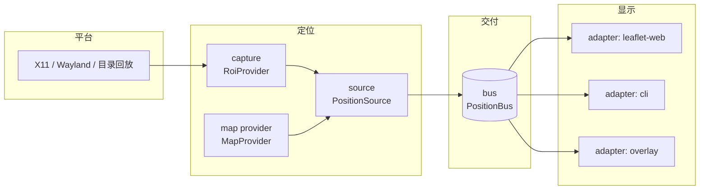

# 架构

## 1. 分层

四个箭头方向固定：**采集 → 定位 → 总线 → 显示**。反向依赖一个都不允许。

## 2. 模块与职责

| 模块 | 职责 | 明确不做 |
|---|---|---|
| `capture/*` | 拿到 ROI 像素 + 时间戳 | 不认游戏、不认坐标、不做窗口管理策略 |
| `maps/*` | 瓦片与「像素 ↔ frame」换算 | 不知道位置怎么算出来的 |
| `sources/*` | 组合 capture + maps + 匹配算法，产出 Position | 不知道谁在消费 |
| `bus/*` | 存/转最新 Position，支持多订阅 | 不做坐标换算、不做业务判断 |
| `adapters/*` | 把 Position 变成某种呈现 | 不产生坐标、不修正坐标 |
| `core/*` | Position 结构、frame 注册、配置 | 不含任何具体实现 |

## 3. 解耦规则（评审重点）

| # | 规则 | 检验方式 |
|---|---|---|
| R1 | 位置源不 import 任何 `adapters/` `bus/` 具体实现，只依赖 `core` 的事件结构 | 静态检查依赖方向 |
| R2 | 坐标换算只发生在边界：位置源产出**它声明的 frame**，适配器换算到自己的坐标 | 新增适配器不需改位置源（FR-12） |
| R3 | 定位只依赖 `MapProvider` 接口，换底图（在线瓦片 → 离线包 → 另一张地图）不改算法 | 用假 MapProvider 跑单元测试 |
| R4 | 传输可替换：`inproc` 与 `http` 是同一协议的两个绑定，事件结构完全一致 | 同一份回归用例跑两种绑定 |
| R5 | 采集只给像素：不含"这是小地图"之类的语义，ROI 由配置给定 | 换成回放目录仍能工作 |
| R6 | 配置与代码分离：ROI、掩膜、门限、frame 参数全在配置文件 | 改配置不改代码能适配一次游戏改版 |
| R7 | 每个端口都有回放/假实现 | M3 的端到端回归全程不启动游戏 |

> R2 是"以后想换地图"的关键：**frame 是唯一契约**。网页地图适配器用 `map.project()` 三点探测求出仿射再求逆；
> 换成 OBS 悬浮层就变成"画面坐标 + 缩放"；换成 3D 应用则是另一套换算。三者互不知道对方存在。

## 4. 数据流

1. `capture` 按 ROI 截帧 → `Frame(ts, image, meta)`
2. `source` 取帧，用 `MapProvider` 的瓦片做匹配（低 zoom 全域 → 高 zoom 局部细化）
3. 命中且 `confidence ≥ 门限` 才构造 `Position`，否则沿用上次并置 `stale=true`
4. `bus` 存最新值，节流后推给订阅者
5. `adapter` 收到后自行换算与呈现；不认识 frame 就拒收并记日志

## 5. 扩展点

| 想做什么 | 只需实现 | 不必碰 |
|---|---|---|
| 换一张网页地图 | 一个 `DisplayAdapter` | 采集、定位、总线 |
| 加桌面悬浮层 / OBS 源 | 一个 `DisplayAdapter` | 同上 |
| 换游戏或换区域 | 一个 `Source` + 一个 `MapProvider` | 总线、适配器 |
| 换平台（Wayland / Windows） | 一个 `RoiProvider` | 定位与显示 |
| 换传输（Unix socket / SSE） | 一个 `Bus` 绑定 | 其余全部 |
| 离线调试 | `dir` 采集 + `replay` 源 | 其余全部 |

## 6. 关键决策

| # | 决策 | 理由 / 代价 |
|---|---|---|
| D1 | 只做定位与发布，不做客户端整合 | 显示端是可替换的适配器；避免和地图前端一起演进 |
| D2 | 用网页地图自己的瓦片做底图 | 坐标与点位天然同源；代价是首次下载 |
| D3 | 不做旋转搜索 | 小地图固定北向上、地图不转 ⟹ 只剩平移 + 固定尺度，复杂度降一档 |
| D4 | 先粗后精的两级搜索 | 避免全图高 zoom 匹配，CPU 可控 |
| D5 | 置信度门限 + 迟滞，宁可不更新也不跳变 | 导航类工具最忌抖动 |
| D6 | 能用 numpy 就不引 OpenCV | 少一个重依赖；实测不够快再换 |
| D7 | 端口只定 5 个，不做插件系统 | 抽象过度会拖慢 M1–M2；扩展点用目录约定而非动态加载 |
| D8 | frame 显式声明并强制校验 | 多显示端场景下，静默错位比报错更糟 |

## 7. 失败模式

| 现象 | 判定位置 | 表现 |
|---|---|---|
| 抓不到画面 | capture | 帧间隔超时 → 暂停，日志 `capture.timeout` |
| 抓到但没有地图纹理 | capture/ROI | 置信度常年低 → 提示重新标定 |
| 匹配到错误位置 | source | 置信度低 + 位置突变 → 丢弃（迟滞拦下） |
| 总线没送达 | bus/adapter | 适配器面板显示"服务离线" |
| frame 不认识 | adapter | 拒收 + 日志 `adapter.unknown_frame` |
